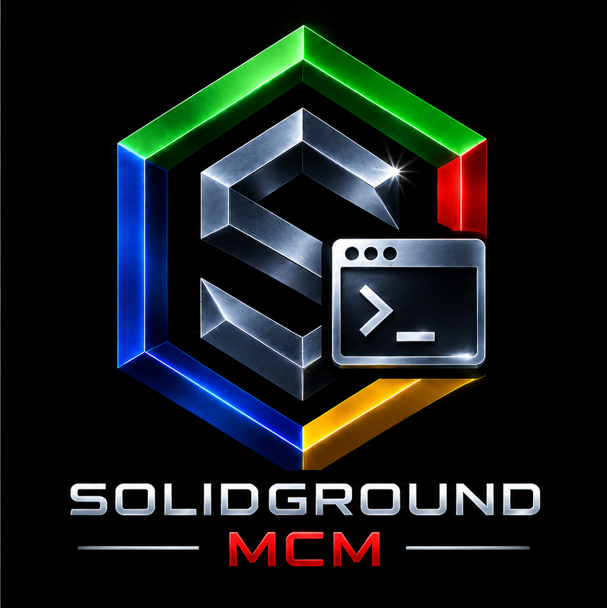

<table>
<tr>
<td width="290" align="center" valign="middle">
  
</td>
<td valign="middle">
  <h2>SolidGroundUX: Management Console Modules</h2>
  <h4>Version 2.2.2631102 R2 · © 2026 Testadura</h4>
</td>
</tr>
</table>

<table>
<tr>
<td width="33%" align="center">
  <a href="https://testadura-consultancy.github.io/SolidGroundUX/"><strong>Documentation</strong></a> 
  Product reference and guides
</td>
<td width="33%" align="center">
  <a href="CHANGELOG.md"><strong>Changelog</strong></a> 
  Releases and development history
</td>
<td width="33%" align="center">
  <a href="LICENSE"><strong>License</strong></a> 
  Terms of use and redistribution
</td>
</tr>
</table>

# SolidGroundUX Management Console Modules 2.2 R2 Release Notes

## Documentation on demand and more consistent console behavior

SolidGroundUX Management Console Modules 2.2 R2 consolidates the major advances made in 2.2. The original release introduced PostgreSQL and MariaDB server modules, a substantially expanded Web Content Manager and an overhauled Python documentation generator. R2 concentrates on reusing those capabilities more effectively and making console actions behave consistently.

## Changes in R2

### Generate documentation from installed products

The **SolidGroundUX Documentation** group now includes **Generate documentation from installed products**.

Instead of relying on prebuilt documentation shipped with each release, this action can reconstruct documentation from the sources and supporting resources installed on the machine. It uses installed release manifests to distinguish which files belong to Framework, SDK and Management Console Modules, even though the products share paths under `/usr/local`.

The action supports:

- Selecting the installed products to document.
- Generating structured Markdown using the existing Python generator.
- Optionally rendering the Markdown as a navigable HTML website through the existing Web Content Management renderer.
- Choosing an output location, with checks for unsuitable paths and output accessibility.

Existing saved documentation bundles and the separate publishing workflow remain unchanged. Generation is an explicit operation; ordinary product updates do not automatically rebuild or publish a website.

### Removal of obsolete documentation defaults

The Web Server and Web Content publishing defaults have been updated to stop assuming the old `/usr/local/share/doc/solidgroundux-codex` location. The current generated-documentation directories are used instead, while existing saved publishing configurations remain preserved.

### Standardized completion behavior

A review of the console menu registrations across 15 MCM modules aligned actions without their own completion dialog to a **30-second** return wait. Actions that already manage their own end-of-action interaction retain a zero-second menu wait, avoiding duplicate dialogs. The existing 35-second Samba status display is also preserved.

This improves the visibility of results and errors, particularly in Web Content Management and related Web Server actions, without changing their underlying operations.

## Foundation established in 2.2

### Server management

- **PostgreSQL Server:** New installation and configuration module, with guided configuration for data storage, access and server resources.
- **MariaDB Server:** New installation and configuration module, with guided configuration and validation.
- **Web Content Management:** Expanded capabilities for creating, editing, organizing and publishing website content.

### Documentation generation and publishing

The documentation system was redesigned and implemented in Python, reducing generation of the full suite reference from roughly 45 minutes to seconds in the development environment. It supports structured bundles and navigation, product and section prefaces and epilogues, images, automatically numbered figures and indexes, plus conversion of generated Markdown into static HTML documentation.

### Consistency and documentation

The Management Console workflows and menus received extensive usability revisions. Source documentation, function descriptions and architecture illustrations were updated across the modules.

## Compatibility and scope

R2 reuses the existing generator, Web Content Manager and release manifests. It does not introduce a new package format, change the underlying server-installation modules or require PDF-rendering dependencies.

PDF export remains planned for **SolidGroundUX 3.0**; the navigable HTML reference is the primary format for the full documentation set.

**Make the difficult easy, without making the difficult impossible.**
